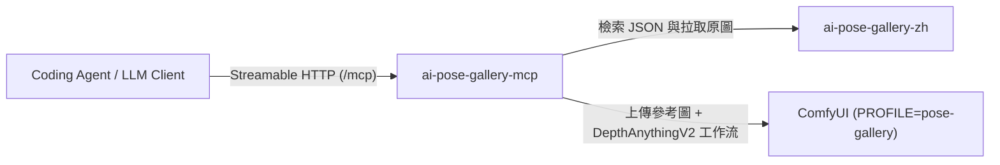

# ai-pose-gallery-mcp：AI 角色參考圖庫檢索與 ComfyUI 多圖合成 MCP Server

為 [kime541200/ai-pose-gallery-zh](https://github.com/kime541200/ai-pose-gallery-zh)（4,345 張全中文姿勢／服裝／人像參考圖庫）提供 **Streamable HTTP MCP Server**，讓 Claude Code、Cursor、Antigravity 等 Coding Agent 或 LLM 客戶端能以自然語言檢索素材並直接驅動本地 ComfyUI 生成角色圖。



---

## 1. 核心能力與 MCP 工具清單

1. **自然語言模糊檢索與互動挑選**：
   - `get_facets`：查詢圖庫所有體系、分類、視角、髮長與 12 種畫風預設（`style_presets`）。
   - `search_portraits` / `search_costumes` / `search_poses`：支援繁／簡中文、多關鍵詞與口語同義詞檢索，回傳候選清單與圖片預覽網址供使用者確認。
   - `get_reference_by_id`：依 ID 查詢單筆素材完整資訊。
2. **提示詞組裝與 ComfyUI 雙引擎多圖合成**：
   - `compose_recipe_prompt`：依選定的人像、服裝、姿勢與畫風自動組裝結構化中文提示詞。
   - `generate_image`：自動從圖庫拉取參考圖、上傳至 ComfyUI，透過 **`FLUX 3 Image Klein Distilled (Int8)`（預設推薦，`workflow_engine="flux3-klein"`）** 或 **`Qwen-Image-Edit-2509`（備選，`workflow_engine="qwen-edit"`）** 結合 `DepthAnythingV2` 3D 深度姿勢預處理直接出圖並回傳圖片 URL。
   - `prepare_comfyui_workflow`：上傳參考圖並匯出填妥節點的 ComfyUI API Workflow JSON，供外部工具或 [kime541200/comfy-mcp](https://github.com/kime541200/comfy-mcp) 進階修改與執行。

---

## 2. 前置需求

使用本 MCP Server 需搭配以下兩個服務：

1. **圖庫服務（必備）**：部署並啟動 [kime541200/ai-pose-gallery-zh](https://github.com/kime541200/ai-pose-gallery-zh)（預設 `http://localhost:8080`）。
2. **ComfyUI 服務（使用 `generate_image` / `prepare_comfyui_workflow` 時必備）**：
   - 需安裝 `comfyui_controlnet_aux`（提供 `DepthAnythingV2Preprocessor`）與對應模型。
   - 推薦直接使用 [kime541200/comfyui-deploy](https://github.com/kime541200/comfyui-deploy) 的 `PROFILE=pose-gallery` 一鍵啟動，模型下載指令詳見 [ai-pose-gallery-zh 的 ComfyUI 說明](https://github.com/kime541200/ai-pose-gallery-zh/blob/main/docs/comfyui.md)。

---

## 3. 快速啟動（Docker）

```bash
cp .env.example .env
# 編輯 .env，將 GALLERY_URL 與 COMFYUI_URL 改為你實際部署的位址與 Port
docker compose up -d --build
curl -s http://127.0.0.1:8090/health
```

在 Agent 的 `mcp_config.json` 加入 Streamable HTTP 端點：

```json
{
  "mcpServers": {
    "ai-pose-gallery": {
      "url": "http://127.0.0.1:8090/mcp"
    }
  }
}
```

- 完整部署、環境變數與本機開發配置請見 [`docs/setup.md`](docs/setup.md)。
- Agent 操作規範與互動流程請見 [`AGENTS.md`](AGENTS.md)。

---

## 4. 相關開源生態系（Ecosystem）

歡迎搭配以下配套專案使用，或提交 Issue / PR 參與開發優化：

| 專案 Repo | 角色與功能說明 |
| --- | --- |
| **[kime541200/ai-pose-gallery-zh](https://github.com/kime541200/ai-pose-gallery-zh)** | **AI 角色參考圖庫與 Web 合成台**：提供 4,345 張全中文姿勢、服裝、人像參考資料與 `/studio` 網頁合成介面。 |
| **[kime541200/comfyui-deploy](https://github.com/kime541200/comfyui-deploy)** | **Docker 化 ComfyUI（Profile 驅動）**：提供 `PROFILE=pose-gallery` 預載 `DepthAnythingV2` 與 `GGUF` 節點。 |
| **[kime541200/comfyui-agent](https://github.com/kime541200/comfyui-agent)** | **AI Agent 生圖工作區**：整合本 MCP 與 [kime541200/comfy-mcp](https://github.com/kime541200/comfy-mcp) 的開箱即用 Agent 工作區。 |
| **[kime541200/lora-training](https://github.com/kime541200/lora-training)** | **Docker 化 LoRA 訓練工具**：以 kohya `sd-scripts` 訓練自訂角色 LoRA。 |
